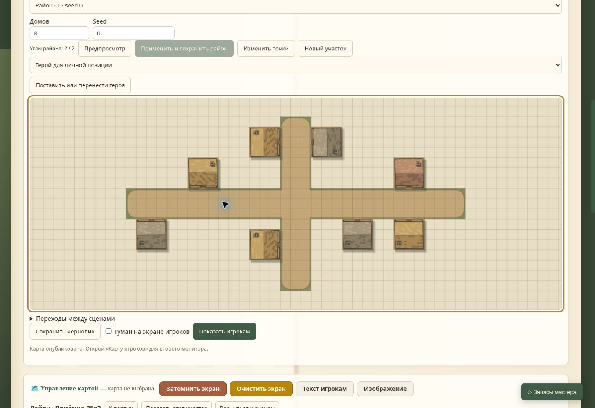
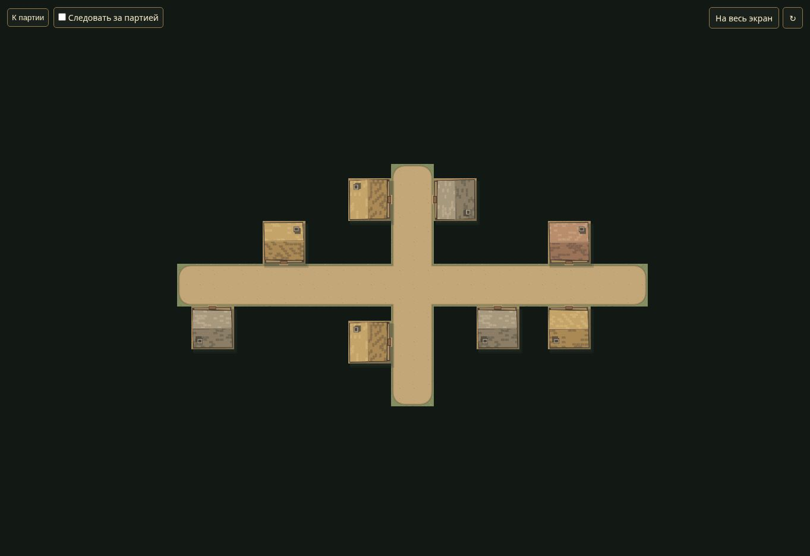

# B5a2 — приёмка компактного предпросмотра в браузере

13 ноября 2026. База — `f8e1b64b2b6f4f85f319ec0d1d79526682b114ba`, с исправлением жеста выбора этого изменения. Настоящий Chrome на Linux, отдельная временная кампания `scripts/browser-qa.cjs`; карта «Район · Приёмка B5a2», сцена «Интерьер · B5a2». Пользовательские кампании не использовались.

## Стенд и результат

Обычный exec запускал сервер в другой сетевой изоляции. Вместо этого тот же скрипт запущен установленным Node по полному пути через терминал Linux-стола, рядом с облачным браузером. Приложение и прокси не менялись, публичного туннеля нет. Доступ к тестовой кампании и настоящая отрисовка подтверждены.

| Сценарий UI | Результат |
| --- | --- |
| Пустая карта, District, два противоположных угла, 8 домов, seed 47 | Предпросмотр и сохранение успешны |
| Undo/Redo первоначального создания | Снимки и выбранный рецепт восстановлены |
| 8→4 дома, seed 0, применение/Undo/Redo | Число домов и seed восстанавливаются, прежний ID рецепта |
| Перезагрузка и загрузка сохранённого рецепта | Восстановлены count 4, seed 0 и контур |
| Создание внутренней сцены и пола через UI | Сохранена клетка (0,0) для входа |
| Выбор дома (11,-3) | После исправления нет случайного переноса, не добавляется Undo |
| Привязка дома | Пара (11,-1) ↔ интерьер (0,0) сохранена |
| Seed 47, регенерация, Undo/Redo со связью | Дом (11,-3) и пара сохраняются |
| Предпросмотр во второй вкладке, удаление пары в первой | Старое применение отклонено сообщением «Переходы изменились. Повтори предпросмотр района.»; preview снят |
| Восстановление пары, новый расчёт на 8 домов | Сохранение успешно, связанный дом и вход остались в списке |
| Публикация без тумана и открытие ТВ | Видны восемь домов и связанные улицы |

## Найденная регрессия и исправление

При первом выборе дома появление панели свойств сдвинуло canvas. Прежний WorldView вычислял перемещение из мировых точек до/после сдвига и ошибочно создавал ручную правку. Этот несохранённый перенос отброшен перезагрузкой перед настройкой связи. Новый тест воспроизвёл сдвиг на шесть клеток; исправление считает только экранный путь указателя при исходном масштабе. Повторный выбор в браузере не изменил карту или историю. Настоящий drag и отмена захвата также проверены тестом.

Полный `npm test` — **71/71**, Node.js 24.22.1. Синтаксис изменённых JS проверен. B5a закрыта; следующий шаг B5b1 — серверное применение района без полного тела карты. Полный PUT/HMAC/сохранения и оформление карты пока прежние. Windows, физические телефоны/ТВ, FPS и реальная LAN в этой приёмке не проверялись.

## Новые кадры

Это снимки фактического приложения после финального сохранения и публикации; графика в этой задаче не менялась.

