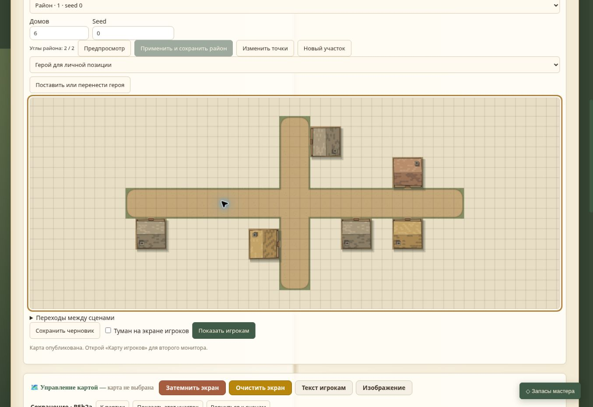

# B5b2a — приёмка применения из редактора

13 ноября 2026. База `608eb603d5745ecbd26aec8b9a557ef46455b5a2` плюс изменения B5b2a. Настоящий Chrome/Linux; новая временная кампания scripts/browser-qa.cjs, карта «Сохранение · B5b2a». Сервер запущен в среде браузера. Пользовательские данные не использовались.

| Сценарий | Результат |
| --- | --- |
| District, два угла, 8 домов/seed 47, применение | Сохранён через новый POST |
| Undo/Redo создания | Работают прежним PUT, выбранный рецепт восстановлен |
| 8→4 дома, seed 0, регенерация и Undo/Redo | Параметры и снимки восстановлены |
| Перезагрузка и загрузка рецепта | count 4, seed 0 и контур сохранены |
| Вкладка B получила preview; A сохранила 6 домов | Применение B отклонено, GET не выдал чужую запись за ожидаемый результат |
| Публикация из A без тумана | Получено подтверждение публикации; финальный редактор показывает 6 домов |

Потерянные ответы и недоступное чтение проверены в VM настоящего редактора/серверного модуля: после записи нет слепого повтора, стеки меняются только при точной сверке. Это не имитация сетевого сбоя в настоящем браузере. Связанные дома и права покрыты действующими HTTP-тестами B5b1; повторная браузерная настройка пары в этом срезе не выполнялась.

Полный npm test — **76/76**. [Сравнение PUT/POST](../benchmarks/B5B2A_APPLY.md): транспорт меньше, но локальный HTTP медленнее; ускорение и снижение памяти не заявляются. Компактная передача истории не реализована, это следующий B5b2b. Windows, физические устройства и FPS не проверены. Графическое оформление в этой задаче не менялось.

