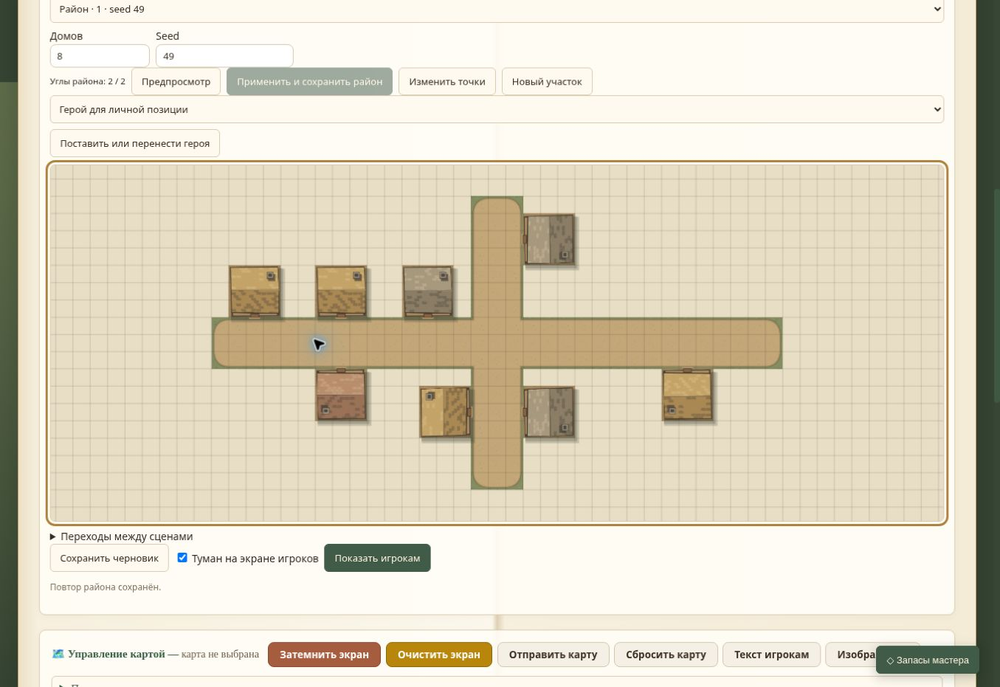

# B5b2b — приёмка компактной истории

13 ноября 2026. База 64ff80092c100f557b5190ceefbde9b1f79f9375 плюс изменения B5b2b. Настоящий Chrome/Linux; одноразовая кампания `scripts/browser-qa.cjs` на портах 3129/3130, собственный временный DATA_DIR. Пользовательские карты не использовались.

| Сценарий через интерфейс | Наблюдаемый результат |
| --- | --- |
| Пустая карта «B5b2b · История района», два угла, 8 домов, seed 47; предпросмотр/применение | «Район сохранён…» |
| Отмена и повтор создания | «Отмена района сохранена.» и «Повтор района сохранён.» |
| Регенерация seed 48, отмена и повтор | После отмены список и поле Seed возвращают 47, после повтора — 48 |
| Вторая вкладка открывает актуальный рецепт 48, сохраняет seed 49 | Подтверждено сохранение |
| Первая вкладка пытается отменить старое состояние | «Карта изменилась. Открой актуальную карту перед продолжением.»; локальный рецепт остаётся 48; Redo не включается |
| Вторая вкладка отменяет/повторяет свою регенерацию | Успех; финальные 8 домов и рецепт seed 49, статус «Повтор района сохранён.» |

Новый кадр снят после последнего повтора; это реальная отрисовка текущего приложения, графика в этой задаче не менялась.

Автоматические уровни: 78/78 в полном npm test. VM проверяет потерю ответа/GET-сверку/стек; HTTP — доступ, дельты, лимиты, повтор, совместимость PUT и сохранность переходов; модульные сценарии — подпись полного снимка, подмены и связанные дома. В браузере потеря сети не имитировалась, новые связи не настраивались, перезагрузка/ТВ повторно не проверялись. Их прежняя приёмка остаётся в B5b2a/F5d3; не выдаётся за новую. Физические устройства/Windows не проверены.

История после открытия страницы и ключ после перезапуска по-прежнему не восстанавливаются. Сервер полностью читает/подписывает снимок. B5b2 закрыта, следующий срез — B5b3a, профиль стадий перед изменением операций хранилища.
