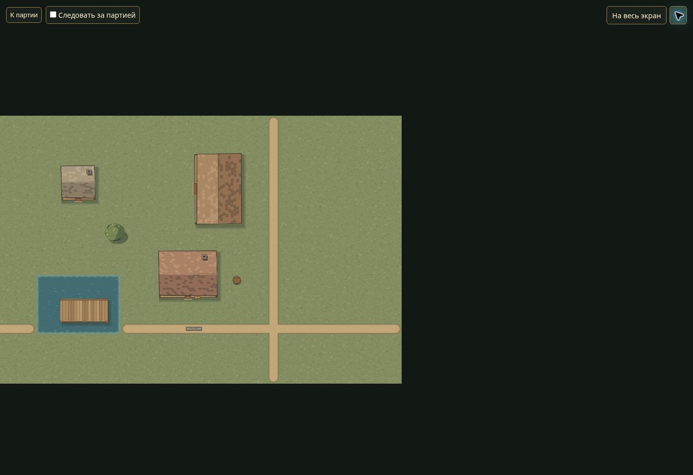
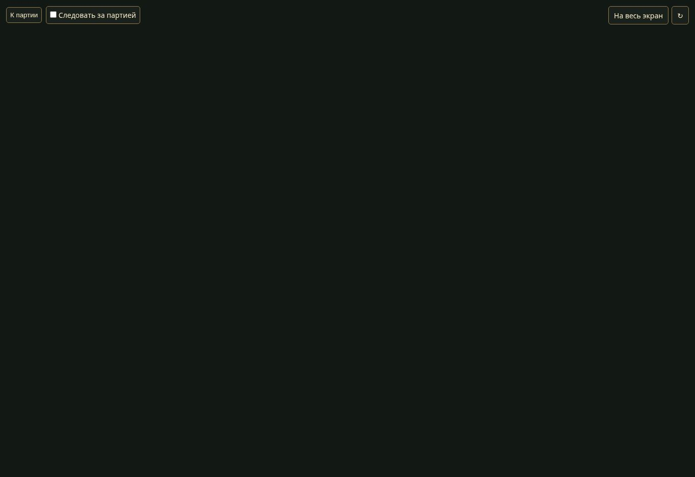

# B5b3d — объекты на границах чанков

14 ноября 2026. База `e7dbaa5d9a166baedce15af6f0b128617a52a2e2` плюс изменения B5b3d.

## Ошибка и исправление

Раньше world-exploration.project выбирал объект только по чанку опорной клетки. Таверна с x=-1 или x=32 отсутствовала в ответе для 0,0, хотя её занимаемые клетки пересекали этот чанк. Новые тесты воспроизвели пропуск до изменения.

Теперь выборка проверяет пересечение cellBounds с запрошенными чанками, включая поворот и отрицательные координаты. Геометрическая выборка не заменяет авторизацию опорной клетки: видимый край не раскрывает невидимую опору, hidden требует прежнего совпадающего раскрытия, память использует прежнее положение/состояние. Известная видимая новая позиция подавляет старую память даже вне запроса; ID в ответе не повторяется. Снимок памяти проходит белый список полей, open двери сохраняется из снимка.

Это занимаемая геометрия, без декоративных выступов крыши/кроны/тени. Их согласованные визуальные границы — следующая B5b3e. Пространственный индекс на диске ещё не реализован, все метаданные по-прежнему читаются.

## Автоматические проверки

Полный npm test — **94/94**, без пропусков, Node.js 24.22.1. Синтаксис всех пяти изменённых JS/тестов проверен.

| Уровень | Проверено |
| --- | --- |
| Новый world-chunk-objects.test.cjs, 4 сценария | Положительные/отрицательные границы, повороты таверны/амбара и направленных стен; отсутствие пересечения, пустая область, несколько чанков без дублей |
| Туман/секреты | Авторизация опоры вне запроса, видимый край с неизвестной опорой, ручная/legacy маска и её приоритеты, запрет свежего fallback при наличии памяти, совпадающее/устаревшее раскрытие hidden, только публичные поля |
| Память | Старое пересекающее положение перемещённого объекта, подавление глобально видимым новым положением, дедупликация живого fallback и памяти, прежний open двери, отсутствие мутаций |
| Настоящий HTTP в sync.test.cjs | Две таверны с опорами -1 и 32 возвращаются для одного 0,0; соседний terrain не добавляется, hidden/далёкий объект отсутствуют; повтор ключей не дублирует ID; запрос без chunks пустой; неизведанный туман скрывает объекты |
| browser-qa.test.cjs | Новая пограничная сцена существует только в одноразовом DATA_DIR, hidden сохранён; прежние изоляция/реальная мастерская авторизация/WS/restart/resume проходят |

Существующие проверки ролей, кампаний, истории/потерянного ответа, сохранений и исследования проходят. Замеры скорости/FPS не выполнялись; ускорение не заявляется.

## Приёмка в браузере

Chrome/Linux, обычные интерфейсы мастера и /tv, временная сцена «Граница чанков · Таверна и амбар» из scripts/browser-qa.cjs. Прокси 3135, реальный сервер 3136, отдельный временный DATA_DIR; пользовательские карты не использовались. Подключённый браузер не смог открыть localhost стенда, поэтому он запущен через терминал Linux-стола в сетевой среде облачного браузера.

1. В мастере открыт пограничный черновик; туман выключен, нажато «Показать игрокам», подтверждена публикация.
2. На экране игроков видны таверна, повёрнутый амбар, дом, мост, дерево/бочка/стена. Скрытый сундук не появился.
3. Камера сдвинута перетаскиванием; сцена перерисовалась, постройки оставались целыми.
4. В мастере включён туман и карта опубликована повторно. Без раскрытий общий экран стал тёмным.
5. Туман выключен, карта опубликована повторно; экран обновлён, сцена восстановилась. Сохранены новые кадры.

Браузер проверяет обычную публикацию/рендер/камеру/туман, **не** изолированный запрос одного чанка: точная геометрия запроса и приватность проверены HTTP и модульно. Физические телефоны/ТВ, Windows и LAN не проверены. Графические алгоритмы/ассеты в этой задаче не менялись; кадр — реальная отрисовка новой тестовой сцены, а не улучшение стиля карт.





## Воспроизведение

```bash
npm test
node --test test/world-chunk-objects.test.cjs
node scripts/browser-qa.cjs
```

Открыть адрес, напечатанный стендом, выбрать «Граница чанков · Таверна и амбар», опубликовать с туманом/без и проверить /tv. Не направлять прокси на рабочую кампанию. В сетевой среде Linux-стола использовать полный путь к установленному Node при необходимости. Для строгой одночанковой регрессии запускать HTTP-тест, а не менять внутреннее состояние браузера.
