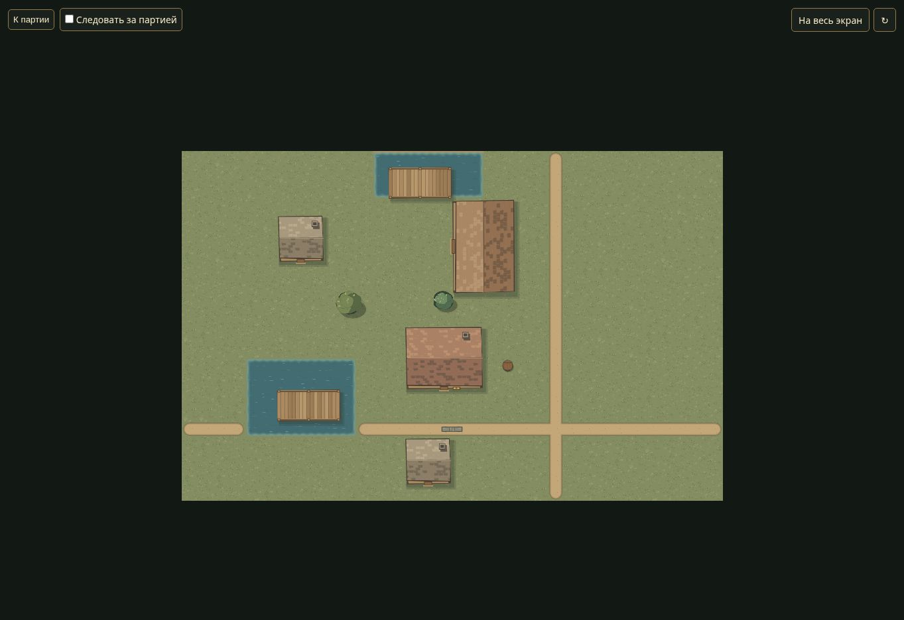
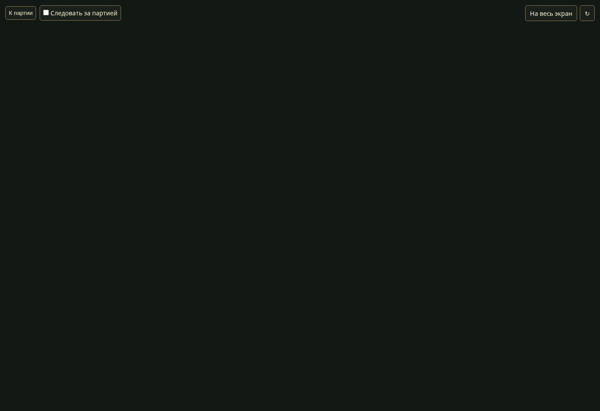

# B5b3e — визуальные выступы объектов

14 ноября 2026. База `c84961e74fed95fb4602eea0577491370e8ec6df` плюс изменения B5b3e.

## Ошибка и общий контракт

Крона дерева в клетке x=31 и крыша дома с последней занимаемой клеткой x=31 не попадали в ответ чанка 1,0, хотя рисунок заходил за x=32. Canvas отдельно использовал произвольный отступ 5 клеток для отсечения по опоре. Регрессионные тесты воспроизвели обе проблемы до подключения общих границ.

WorldMap.visualBounds возвращает консервативный прямоугольник рисунка в мировых координатах; right/bottom — исключающие края. Его используют серверная выборка и отсечение Canvas. Физические footprint/cellBounds, коллизии и обзор не меняются.

| Группа | Визуальная оболочка |
| --- | --- |
| Дерево/куст | Точный прямоугольник кешированной кроны 2.4×2.4 с прежним детерминированным смещением; общий crownFrame используется и paintCrown |
| Дом/таверна/амбар/мост | Поворотный footprint + .3 с каждой стороны; включает полотно крыши и фиксированную юго-восточную тень до .29 |
| Каменная стена | Footprint + .002; учитывает соединительные заливки .501 относительно центра клетки |
| Остальные объекты | Максимум .6 размера footprint и половины размера + .2 по каждой оси; покрывает нормализованный декор, наклон повозки, круглые окончания линий, fallback-тень, контур выбора и спрайт с максимальной стороной .98 |

Это прямоугольные оболочки, включая прозрачные поля кешированного полотна. Они могут выбрать лишний уже разрешённый объект у края; совпадение с непрозрачным силуэтом пиксель в пиксель не заявляется. Формулы существующего рисунка/смещений сохранены, новых ассетов/стиля нет. При изменении рисунка нужно поддерживать границы и тест покрытия.

Авторизация опоры, память, раскрытие hidden и маски тумана остаются прежними. Декоративный выступ сам по себе не раскрывает объект/местность. Соседние тайлы не добавляются.

## Автоматические проверки

Полный npm test — **97/97**, без пропусков, Node.js 24.22.1; синтаксис девяти изменённых JS/тестов проверен.

- Новый world-visual-bounds.test.cjs: дерево, крыша и тень моста выбираются при отсутствии занимаемых клеток в запрошенном чанке; неизвестная опора не раскрывается, совпадающее раскрытие hidden необходимо. Проверены отрицательная граница и старое положение кроны в памяти.
- Запись команд настоящего paintProp покрывает все известные типы, четыре поворота, 32 варианта координат/крон, выбранное состояние и оба состояния загрузки спрайтов. Учитываются преобразования, прямоугольники, пути/контрольные точки, stroke и drawImage. Offscreen-рисунок ограничивается прямоугольником drawImage; для загруженных спрайтов проверяется максимальный квадрат .98, содержащий любой допустимый аспект. Это геометрическая проверка команд, не сравнение растров.
- VM настоящего world-view проверяет, что выступ кроны у края viewport рисуется, а полностью внешний объект отсеивается общей оболочкой. Граница без положительной площади пересечения не считается пересечением.
- Настоящий HTTP в sync.test.cjs получает крону и крышу при запросе 1,0, хотя их физические клетки заканчиваются в соседнем чанке; сохраняются проверки отсутствия чужого terrain/секретов/дублей и тумана. Прежние геометрические, роли/кампании/история/сохранения/обзор проходят.

## Браузерная приёмка

Chrome/Linux, свежий сервер одноразового scripts/browser-qa.cjs, порты 3141/3142, новая сцена «Граница чанков · Выступы крыш и крон». Данные пользователя не использовались. Использована сетевая среда облачного браузера через терминал Linux-стола: подключённый браузер ранее не мог обратиться к localhost рабочего окружения.

1. В мастере выбран новый черновик; выключен туман, карта опубликована.
2. На обычном /tv видны дополнительная крона у пересечения чанков, дом с выступом крыши и мост/тень над верхним водоёмом; тайный сундук не появился.
3. Камера сдвинута перетаскиванием; рисунок обновляется и обрезается краем viewport.
4. Включён туман и повторная публикация: неисследованная карта скрыта полностью.
5. Туман выключен; после публикации и перезагрузки /tv сцена восстановилась, снят новый центральный кадр.

Строгий запрос одного чанка и точное геометрическое покрытие проверены HTTP/модульно, а не подменой запросов браузера. Браузер проверяет обычный renderer/публикацию/камеру/туман. FPS/LAN/Windows и физические устройства не измерялись. Нового художественного качества этим исправлением не заявляется.





## Воспроизведение

```bash
npm test
node --test test/world-visual-bounds.test.cjs
node scripts/browser-qa.cjs
```

В одноразовом стенде выбрать «Граница чанков · Выступы крыш и крон», опубликовать с туманом/без и проверить /tv. Если сервер запускается в сетевой среде Linux-стола, указать полный путь к установленному Node. Не направлять прокси на рабочие кампании.

Полное чтение списка объектов/манифеста остаётся. Следующая B5b3f — замер чтения метаданных общего экрана и памяти исследования, затем конкретный контракт пространственной выборки без изменения формата в диагностическом срезе.
