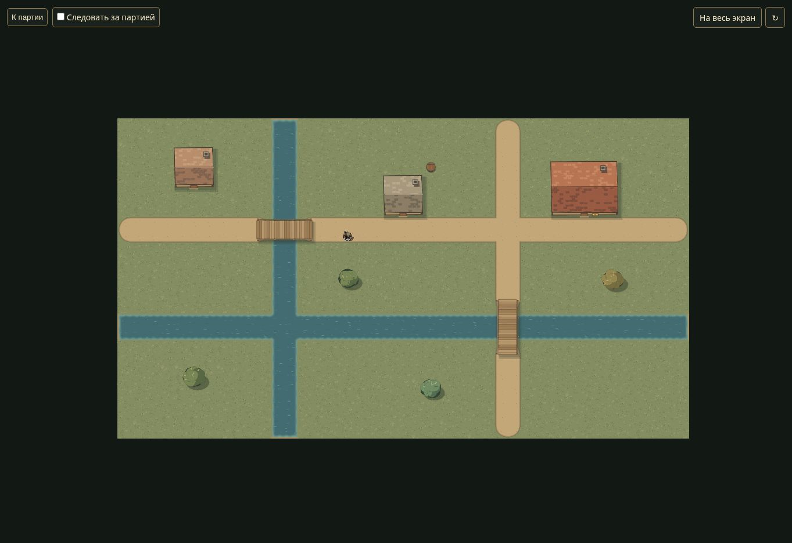
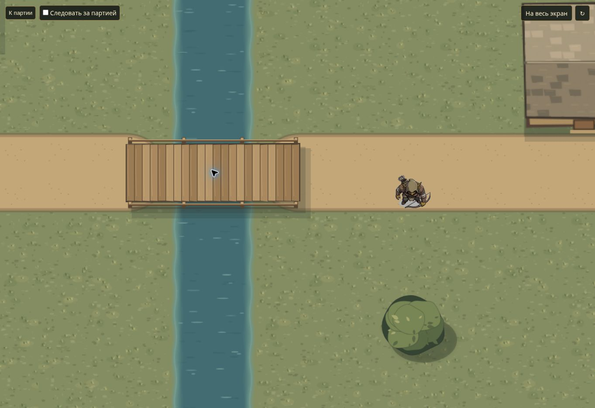
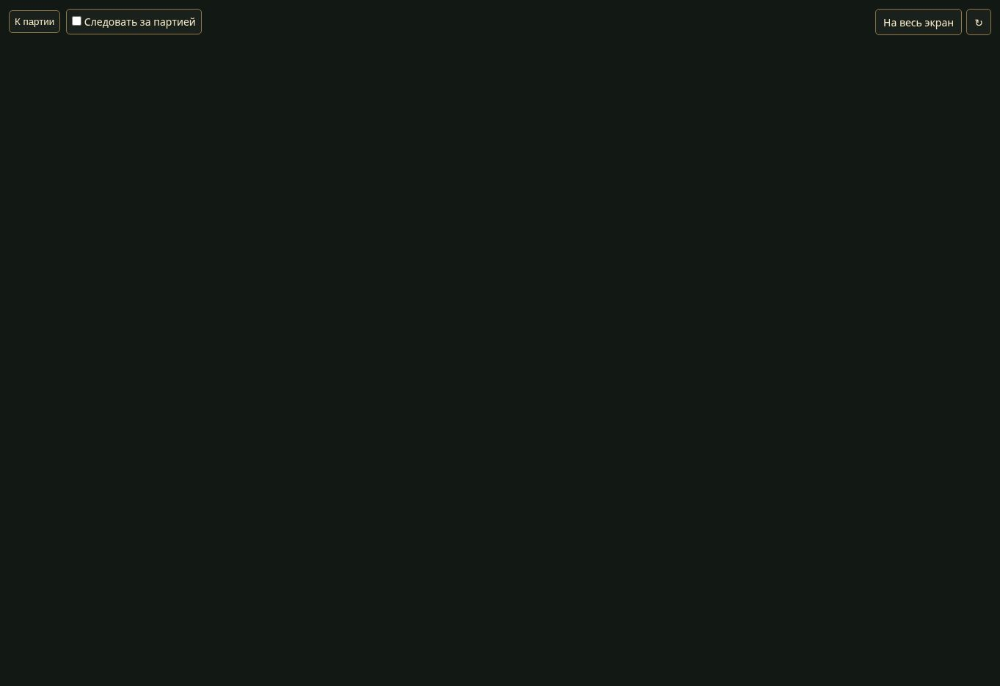

# V1b — пропорции мостов

Дата: 14 ноября 2026. База: 021c000dad82bccef9c556a062ad308ffd9a2f33, ветка codex/audit-and-stabilization. Приоритет задан замечанием пользователя о несоразмерном мосте.

## Исправление

Прежний широкий настил 4×2 и массивные боковые балки выглядели деревянной площадкой. В прежней пограничной QA-сцене мосты также стояли внутри слишком широкого водоёма без связи с берегами; та сцена проверяет границы чанков и сохранена.

В общем Canvas renderer настил сужен до 4×1.36 клетки, доски, перила и стойки сделаны тоньше. Тень сужена по соответствующей оси при повороте. Физический footprint 4×2, движение и обзор не менялись: центры проходимых рядов остаются внутри настила. Новых изображений или зависимостей нет.

Для проверки добавлена отдельная одноразовая сцена «Мосты · Берега и масштаб». Каждый из двух мостов пересекает двухклеточную протоку, имеет сухие концы и подходы. Горизонтальный и вертикальный варианты показаны рядом с домами, таверной и существом. Это тестовая расстановка: существующие кампании и координаты их объектов не меняются.

## Автоматические проверки

- Полный npm test: **97/97**, без пропусков, Node.js 24.22.1.
- В test/browser-qa.test.cjs настоящие HTTP и world-movement проверяют размеры, проход обоих мостов от берега до берега, сухие концы/подходы и непроходимую воду сбоку.
- Существующие проверки paintProp/visualBounds всех типов, четырёх поворотов и вариантов проходят с новым рисунком.
- node --check проходит для remote/world-art.js, scripts/browser-qa.cjs и test/browser-qa.test.cjs.

## Проверка настоящего приложения

Chrome/Linux, свежий временный DATA_DIR: запущен scripts/browser-qa.cjs, выбран новый черновик, выключен туман, нажата «Показать игрокам», открыт /tv. Проверены пропорции обоих мостов и наличие берегов. Колёсиком приближен горизонтальный мост: тонкие перила, поперечные доски, тень и масштаб существа читаются. Туман без открытий скрывает сцену целиком; повторная публикация без тумана и перезагрузка возвращают карту. Скрытый тестовый сундук отсутствует на общем экране.

Общий экран:

Приближение в приложении:

Проверка тумана:

## Ограничения и продолжение

Это локальное исправление пропорций, не завершение визуального качества Canvas of Kings. Берега и переходы покрытий остаются упрощёнными. Рисунок не подгоняет автоматически длину моста под любой водоём и не исправляет расстановку на прежних картах. FPS, Windows и физические ТВ/телефоны не проверялись. Следующая задача плана — B5b3f, профиль пространственного чтения общего экрана; B5b3 целиком открыта.
